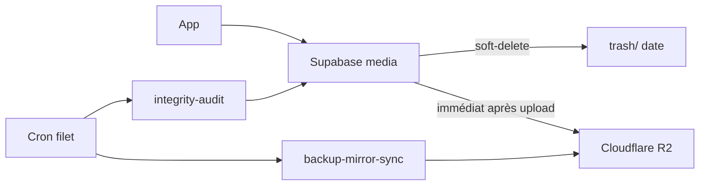

# Durabilité médias (backup) — Petitmo

**Contexte** : Supabase Storage **ne versionne pas** les objets. Un `remove` est définitif.  
La promesse produit (« souvenirs sauvegardés ») exige donc **plusieurs couches**.

## Architecture cible (3-2-1 adapté)

| Couche | Quoi | Statut |
|---|---|---|
| **L0** | SQLite + sandbox téléphone | Déjà (UX local-first, pas une backup cloud) |
| **L1** | Bucket Supabase `media` (primaire) | Prod |
| **L1b** | Soft-delete → `trash/YYYY-MM-DD/…` (90 j avant purge) | **Code worker** |
| **L2** | Vérif post-upload + audit intégrité cron | **Code app + Edge** |
| **L3** | Miroir **Cloudflare R2** (2ᵉ copie externe) | **Code worker** — activer secrets |



## Pourquoi Cloudflare R2 (choix produit)

- S3-compatible, **pas de frais d’egress** typiques AWS (coût prévisible pour vidéos)
- 2ᵉ fournisseur ≠ Supabase (vrai hors-site)
- Simple à brancher sur le media-worker déjà sur Railway

Alternatives OK : Backblaze B2, AWS S3 versionné. **Pas** : seul zip quotidien, recompresser les vidéos.

## Copie immédiate (chemin nominal)

Dès qu’un upload Storage est **vérifié** côté app → Edge `mirror-media-to-r2` → worker `/backup-mirror-object` → R2.  
Le **cron quotidien** reste un **filet** (oublis / échecs réseau), pas le seul mécanisme.

## Textes / métadonnées (Postgres → R2)

Les souvenirs `text` (et captions / titres / lieux / refs `*_path`) vivent en **Postgres**, pas dans le bucket `media`.  
2ᵉ copie hors-site :

| Moment | Mécanisme |
|---|---|
| Insert texte cloud OK | Edge `mirror-memory-meta-to-r2` → `/backup-memory-meta` |
| Edit texte / titre cloud OK | idem (écrase le JSON) |
| Cron filet | `/backup-memories-meta-sync` (via `media-integrity-audit` si `mirror` ou `meta`) |

Clé R2 : `{userId}/_meta/memories/{memoryId}.json`  
Payload `v:1` : `content`, `text_title`, `location`, dates, `media_path` / extras — **pas** d’URLs signées.

## Activer le miroir R2 (aujourd’hui)

1. Cloudflare → R2 → Create bucket `petitmo-media-mirror`
2. Create API token (Object Read & Write) → `Access Key ID` + `Secret`
3. Railway → `petitmo-media-worker` → variables :

| Variable | Exemple |
|---|---|
| `R2_ACCOUNT_ID` | id compte Cloudflare |
| `R2_ACCESS_KEY_ID` | … |
| `R2_SECRET_ACCESS_KEY` | … |
| `R2_BUCKET` | `petitmo-media-mirror` |

4. Redéployer le media-worker
5. Smoke :

```bash
curl -sS -X POST "$MEDIA_WORKER_URL/backup-mirror-sync" \
  -H "Content-Type: application/json" \
  -H "X-Worker-Secret: $MEDIA_WORKER_SECRET" \
  -d '{"limit":20,"offset":0}'
```

6. Brancher le cron Supabase (quotidien) :

```sql
-- Exemple pg_cron : audit + mirror
select cron.schedule(
  'petitmo-media-integrity',
  '15 4 * * *',
  $$
  select net.http_post(
    url := 'https://gswtsnhmwjwhwjdiijbs.supabase.co/functions/v1/media-integrity-audit',
    headers := jsonb_build_object(
      'Authorization', 'Bearer ' || (select decrypted_secret from vault.decrypted_secrets where name = 'media_integrity_cron_secret' limit 1),
      'Content-Type', 'application/json'
    ),
    body := '{"limit":100,"mirror":true,"mirrorLimit":40,"meta":true,"metaLimit":100}'::jsonb
  );
  $$
);
```

Smoke méta (backfill) :

```bash
curl -sS -X POST "$MEDIA_WORKER_URL/backup-memories-meta-sync" \
  -H "Content-Type: application/json" \
  -H "X-Worker-Secret: $MEDIA_WORKER_SECRET" \
  -d '{"limit":50,"offset":0,"types":["text"]}'
```

Secrets Edge à poser : `MEDIA_INTEGRITY_CRON_SECRET` (= ou dérivé de `MEDIA_WORKER_SECRET`), `MEDIA_WORKER_URL`, `MEDIA_WORKER_SECRET`.

## Soft-delete

`DELETE` souvenir → worker **déplace** vers `trash/YYYY-MM-DD/<ancien-chemin>` (plus de `remove` immédiat).  
Récupération manuelle possible depuis le dashboard Storage / S3.  
**TODO P1** : cron purge `trash/` > 90 jours.

## Audit intégrité

- Worker `POST /media-integrity-audit` : compare `memories.media_path` ↔ objet présent
- Edge `media-integrity-audit` : wrapper cron + logs CRITICAL si manquant
- App : verify post-upload + Sentry `media.cloud.integrity` + repair local→cloud si possible

## Coût (ordre de grandeur)

- R2 ≈ prix storage × **2** (primaire + miroir) + writes
- Soft-delete : storage trash temporaire (~rétention 90 j)
- Pas de recompression vidéo (déjà compressée ; qualité souvenir prioritaire)

## Déploiement checklist

- [ ] Déployer media-worker (soft-delete + audit + mirror + meta)
- [ ] `supabase functions deploy media-integrity-audit`
- [ ] `supabase functions deploy mirror-media-to-r2`
- [ ] `supabase functions deploy mirror-memory-meta-to-r2`
- [ ] Secrets R2 sur Railway
- [ ] Cron quotidien audit (+ `mirror:true` / méta)
- [ ] OTA app (verify upload + mirror média + meta texte)
- [ ] Smoke : 1 vidéo → R2 ; 1 texte → `{user}/_meta/memories/….json` ; delete → `trash/`
