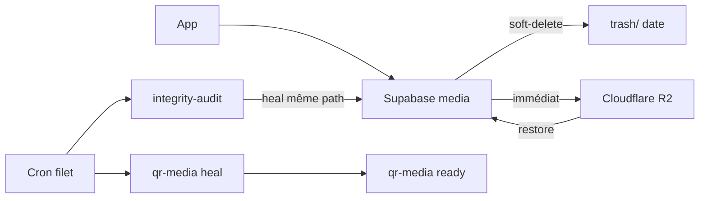

# Durabilité médias (backup) — Petitmo

**Contexte** : Supabase Storage **ne versionne pas** les objets. Un `remove` est définitif.  
La promesse produit (« souvenirs sauvegardés ») exige donc **plusieurs couches** + **heal silencieux**.

**Low Friction / local-first :** l’utilisatrice ne doit **jamais** écrire au support pour récupérer une copie. Restore R2 → Supabase = fond uniquement (zéro Alert).

## Architecture cible (3-2-1 adapté)

| Couche | Quoi | Statut |
|---|---|---|
| **L0** | SQLite + sandbox téléphone | Déjà (UX local-first) |
| **L1** | Bucket Supabase `media` (primaire) | Prod |
| **L1b** | Soft-delete → `trash/YYYY-MM-DD/…` (90 j avant purge) | Worker + cron purge |
| **L2** | Vérif post-upload + audit + **heal R2** | App + Edge + worker |
| **L3** | Miroir **Cloudflare R2** (médias + méta + QR) | Worker |



## Copie immédiate (chemin nominal)

Dès qu’un upload Storage est **vérifié** côté app → Edge `mirror-media-to-r2` → worker `/backup-mirror-object` → R2.  
Le **cron quotidien** reste un **filet** (oublis / échecs réseau), pas le seul mécanisme.

## Heal silencieux R2 → Supabase (médias)

Si `memories.media_path` pointe vers un objet **absent** du bucket `media` :

1. Worker tente `GetObject` R2 sur **la même clé**
2. Si présent → `upload` Supabase **même path** (pas de nouvel id / path)
3. Si absent aussi en R2 → log CRITICAL `r2_also_missing`

Endpoints :

- `POST /backup-restore-object` `{ path }`
- `POST /media-integrity-audit` `{ healFromR2: true }` (défaut si R2 configuré)

### Smoke heal média (compte test)

```bash
# 1) Choisir un path déjà mirroiré (présent R2 + Supabase)
# 2) Supprimer UNIQUEMENT l’objet dans Supabase Storage media (pas R2)
# 3) Heal :
curl -sS -X POST "$MEDIA_WORKER_URL/media-integrity-audit" \
  -H "Content-Type: application/json" \
  -H "X-Worker-Secret: $MEDIA_WORKER_SECRET" \
  -d '{"limit":50,"types":["photo","video","voice"],"healFromR2":true}'
# Attendu : restoredCount >= 1, objet réapparu au même path
```

## Textes / métadonnées (Postgres → R2)

| Moment | Mécanisme |
|---|---|
| Insert / edit texte cloud OK | Edge `mirror-memory-meta-to-r2` → `/backup-memory-meta` |
| Cron filet | `/backup-memories-meta-sync` |
| Ligne Postgres **absente** | `/backup-restore-memory-meta` `{ memoryId, userId }` — **même id** |

Clé R2 : `{userId}/_meta/memories/{memoryId}.json`

### Smoke heal texte

```bash
# Après export meta OK, supprimer la ligne memories (compte test), puis :
curl -sS -X POST "$MEDIA_WORKER_URL/backup-restore-memory-meta" \
  -H "Content-Type: application/json" \
  -H "X-Worker-Secret: $MEDIA_WORKER_SECRET" \
  -d '{"memoryId":"<uuid>","userId":"<uuid>"}'
# Attendu : restored:true, même content
```

## QR livre (`qr-media`) — stock distinct

Tokens `public_media_tokens` : **token + ready_path immuables** (voir `qr-media-permanence.md`).

| Action | Endpoint / hook |
|---|---|
| Miroir immédiat après `ready` | PDF server → `/backup-mirror-qr-object` (si `MEDIA_WORKER_*` sur Railway PDF) |
| Filet + heal | `/backup-qr-sync` `{ healFromR2: true }` |
| Restore un ready | `/backup-restore-qr-object` `{ path: "ready/{token}.ext" }` |
| Scan `/m/{token}` | `tryHealReadyTokenFromStorage` : archive puis R2 |

Clés R2 : `qr-media/ready/…`, `qr-media/archive/…`, `_meta/public_media_tokens/{token}.json`  
**Jamais** de nouveau token après heal.

### Smoke QR

```bash
curl -sS -X POST "$MEDIA_WORKER_URL/backup-qr-sync" \
  -H "Content-Type: application/json" \
  -H "X-Worker-Secret: $MEDIA_WORKER_SECRET" \
  -d '{"limit":20,"healFromR2":true}'
```

## Soft-delete + purge 90 j

`DELETE` souvenir → `trash/YYYY-MM-DD/…`  
Purge : `POST /backup-purge-trash` `{ days: 90 }` (cron quotidien).

## Cron prod

Migration : `supabase/migrations/20261111160000_schedule_media_integrity_heal_cron.sql`  
Vault : `project_url` + `media_integrity_cron_secret`  
Edge body : `heal`, `mirror`, `meta`, `qr`, `purgeTrash`.

Secrets Edge : `MEDIA_INTEGRITY_CRON_SECRET`, `MEDIA_WORKER_URL`, `MEDIA_WORKER_SECRET`.  
Railway **PDF** (heal scan QR) : optionnel `MEDIA_WORKER_URL` + `MEDIA_WORKER_SECRET`.

## OTA app

Publier une OTA `production` pour activer côté client : verify upload, mirror média immédiat, mirror méta texte.  
Sans OTA : cron + worker couvrent déjà le filet heal.

## Déploiement checklist

- [x] Worker restore + audit heal + meta + QR + purge
- [x] Edge `media-integrity-audit` (heal / qr / purge)
- [x] Edges `mirror-media-to-r2` / `mirror-memory-meta-to-r2`
- [ ] Appliquer migration cron + vault `media_integrity_cron_secret`
- [ ] `MEDIA_WORKER_*` sur service Railway PDF (QR immédiat + heal scan)
- [ ] OTA app
- [ ] Smoke heal média + texte + QR
